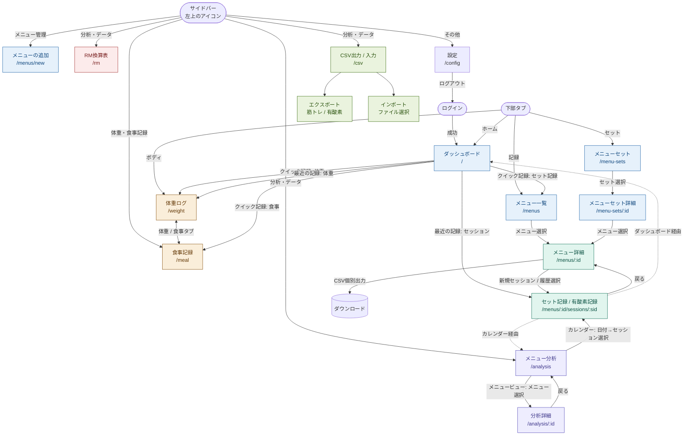

# Workout tracker 画面遷移図

## 改訂履歴

| バージョン | 日付 | 内容 |
|---|---|---|
| 1.0〜1.4 | 2026-03-22〜08-15 | 素のJS版。メニュー分析・RM換算表・メニューセット・メニューセット詳細まで |
| 2.0 | 2026-10-11 | **React移行（フェーズ3）に合わせて改訂**。ログイン、ダッシュボード（初期画面）、体重・食事、設定、下部タブ、URL（ルート）を反映。画面ID（`set-edit` など）はルートに置き換え |

---

## 画面一覧

| 画面名 | ルート（HashRouter。例: `#/menus`） | 色分け |
|---|---|---|
| ログイン | （未ログイン時のみ） | 灰 |
| ダッシュボード | `/` | 青 |
| メニューの追加 | `/menus/new` | 青 |
| メニュー一覧 | `/menus` | 青 |
| メニュー詳細 | `/menus/:menuId` | 緑 |
| セット記録（筋トレ）/ 有酸素記録 | `/menus/:menuId/sessions/:sessionId`（新規は `new`） | 緑 / 橙 |
| メニューセット | `/menu-sets` | 青 |
| メニューセット詳細 | `/menu-sets/:setId` | 青 |
| メニュー分析 | `/analysis`（`?tab=&y=&m=&d=`） | 紫 |
| 分析詳細 | `/analysis/:menuId` | 紫 |
| 体重ログ | `/weight` | 黄 |
| 食事記録 | `/meal` | 黄 |
| RM換算表 | `/rm` | 赤 |
| CSV出力 / 入力 | `/csv` | 緑 |
| 設定 | `/config` | 灰 |
| OAuth同意画面 | `/oauth-consent.html`（単独ページ。MCP連携の許可） | 灰 |

---

## 遷移図

---

## 遷移詳細

### 起動とログイン

| 状態 | 表示 |
|---|---|
| 未ログイン | ログイン画面のみ（アプリ本体は出ない） |
| ログイン成功 | ダッシュボード（ホーム）。ログイン状態は再読み込み後も維持される |
| ログアウト / ユーザー切替 | ログイン画面へ。表示位置は `#/` に戻し、端末の閲覧キャッシュを消す |

### 下部タブからの遷移

| タブ | 遷移先 | 点灯する画面 |
|---|---|---|
| ホーム | ダッシュボード | `/` |
| 記録 | メニュー一覧 | `/menus` 以下（メニュー詳細・セット記録を含む） |
| セット | メニューセット | `/menu-sets` 以下 |
| ボディ | 体重ログ | `/weight`, `/meal` |

メニュー分析・RM換算表・CSV・設定を開いているときは、どのタブも点灯しない。

### サイドバーからの遷移

左上のアイコンで開く。項目をタップすると遷移し、サイドバーは閉じる。オーバーレイのタップでも閉じる。

| セクション | 項目 |
|---|---|
| メニュー管理 | メニューの追加 |
| 分析・データ | メニュー分析 / RM換算表 / CSV出力・入力 |
| 体重・食事記録 | 食事記録 |
| その他 | 設定 |

### ダッシュボードからの遷移

| 遷移先 | 操作 |
|---|---|
| メニュー一覧 | クイック記録「セット記録」 |
| 体重ログ | クイック記録「体重」／最近の記録の体重の行 |
| 食事記録 | クイック記録「食事」 |
| セット記録 | 最近の記録のセッションの行（戻ると、ダッシュボードに戻る） |

### メニュー一覧からの遷移

| 遷移先 | 操作 |
|---|---|
| メニュー詳細 | メニュー行をタップ（つまみ以外） |
| （遷移なし） | 行左端のつまみをドラッグ → 同一部位内で並び替え（DBに保存） |

### メニュー詳細からの遷移

| 遷移先 | 操作 | 条件 |
|---|---|---|
| セット記録 / 有酸素記録（新規） | 「新規セッション」ボタン | 非アーカイブ時。メニューの種類で画面の内容が切り替わる |
| セット記録 / 有酸素記録（既存） | 履歴テーブルの行をタップ | 記録済みセッションがある場合 |
| （遷移なし） | 履歴の✕でセッション削除、「CSV出力」ボタンでダウンロード | 確認ダイアログあり（削除） |
| メニュー一覧 または メニューセット詳細 | 戻るボタン | 遷移元で切替（「一覧に戻る」/「セットに戻る」） |

### セット記録 / 有酸素記録からの遷移

戻り先は、遷移時に渡された `location.state.from`。

| 遷移先 | 条件 |
|---|---|
| メニュー詳細 | メニュー詳細から遷移した場合 |
| メニュー分析（同じ月・選択日） | カレンダーから遷移した場合（F-03） |
| ダッシュボード | ダッシュボードの最近の記録から遷移した場合 |

新規セッション（`sessions/new`）は、最初のセット（有酸素は「記録を保存」）を保存するまでDBに作られない。保存すると実際のセッションIDのURLに置き換わる。

### メニューセットからの遷移

| 遷移先 | 操作 |
|---|---|
| メニューセット詳細 | セットカード本体をタップ |
| 作成/編集モーダル | 「＋ 新規セットを作成」／カード内「編集」ボタン（カード本体のクリックと分離） |

作成・編集・削除の入力はモーダル内で完結し、画面遷移は発生しない。

### メニューセット詳細からの遷移

| 遷移先 | 操作 |
|---|---|
| メニュー詳細 | メンバーメニューの行をタップ（戻ると「セットに戻る」） |
| （遷移なし） | つまみのドラッグでセット内の並び替え |
| メニューセット一覧 | 「セット一覧に戻る」ボタン |

### メニュー分析からの遷移

| タブ | 操作 | 遷移先 |
|---|---|---|
| カレンダー | 日付タップ → セッション行をタップ | セット記録（該当セッション）（F-02） |
| メニュービュー | メニュー行をタップ | 分析詳細 |

タブ・年月・選択日は URL のクエリ（`?tab=&y=&m=&d=`）に保持され、戻る・再読み込みで復元される。

### 分析詳細からの遷移

| 遷移先 | 操作 |
|---|---|
| メニュー分析 | 「分析に戻る」ボタン |

### 体重ログ / 食事記録

「体重」「食事」タブで行き来する。記録・編集・削除は同じ画面内で完結する。

### 設定

アカウント（メールアドレス）の表示と「ログアウト」ボタン。

### RM換算表（遷移なし）

独立した計算ページ。他画面への遷移はない。

### CSV画面（遷移なし）

エクスポート（筋トレ/有酸素）はダウンロード、インポートはファイル選択後に取り込みを実行し、結果の件数を同じ画面に表示する。

---

## 補足

- アプリ起動時の初期表示はダッシュボード（`/`）。
- 画面は URL（`#/…`）で表せるため、ブラウザの戻る/進む、再読み込みでも同じ画面に戻る。未知のURLはダッシュボードを表示する。
- メニュー詳細は「メニュー一覧」「メニューセット詳細」の2箇所から遷移でき、戻るボタンの遷移先・ラベルは遷移元に応じて切り替わる。
- セット記録画面は筋トレ・有酸素運動で同じルートを共有し、メニューのカテゴリによって表示フォームが切り替わる。
- アーカイブ済みメニューでは「新規セッション」ボタンが非表示になる。
- 通信がないとき（オフライン）は、過去の記録の閲覧のみ可能。書き込みの操作はエラーを知らせる。
- 新しい版が見つかると画面上部に「新しいバージョンがあります」と「更新」ボタンが出る。
- OAuth同意画面（`/oauth-consent.html`）は、MCP連携（Claudeからのアクセス許可）で、Supabase Authから開かれる。本体のアプリとは別のページ。
